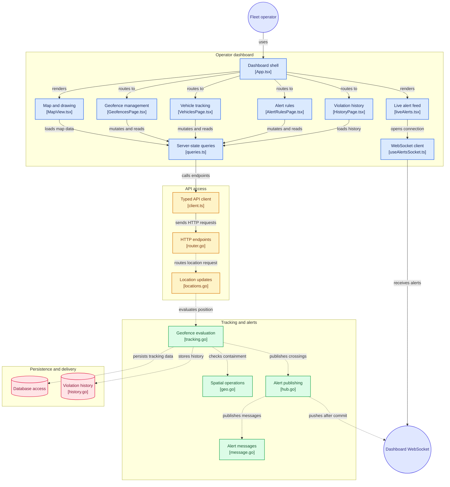

# Geofence Alert System

Real-time geofencing and vehicle tracking, built for the MapUp Full-Stack Developer assessment.

Draw zones on a map, register vehicles and stream their positions. The system works out every entry and exit with PostGIS, stores the full history, and pushes alerts to every open dashboard over WebSocket the moment a vehicle crosses into a restricted zone or matches an alert rule.

## Run it

```bash
docker compose up --build
```

Then open http://localhost:3000 (UI), with the API at http://localhost:8080. Everything else (local development, configuration, curl examples for every endpoint, the WebSocket, design decisions and deployment) is in **[SETUP.md](SETUP.md)**.

## Stack

| Part      | Tech                                                                                 |
| --------- | ------------------------------------------------------------------------------------ |
| API       | Go (stdlib `net/http`), pgx, gorilla/websocket                                       |
| Database  | PostgreSQL 16 + PostGIS 3.4 (GiST-indexed `ST_Covers` containment)                   |
| Real-time | WebSocket hub at `/ws/alerts`, alerts persisted and published after commit           |
| Frontend  | React 19, Vite, TypeScript, Tailwind, react-leaflet + leaflet-geoman, TanStack Query |
| Infra     | Multi-stage Docker images, Docker Compose, Render (API + Postgres), Vercel (UI)      |

## Repository layout

```text
backend/    Go API: cmd/api (wiring), internal/{httpapi,tracking,alerts,store,geo,ids}, migrations/, scripts/
frontend/   React app: src/{api,hooks,context,components,pages}
SETUP.md    Setup, API guide, architecture, decisions
Makefile    Common tasks: `make help`
```

## Architecture


